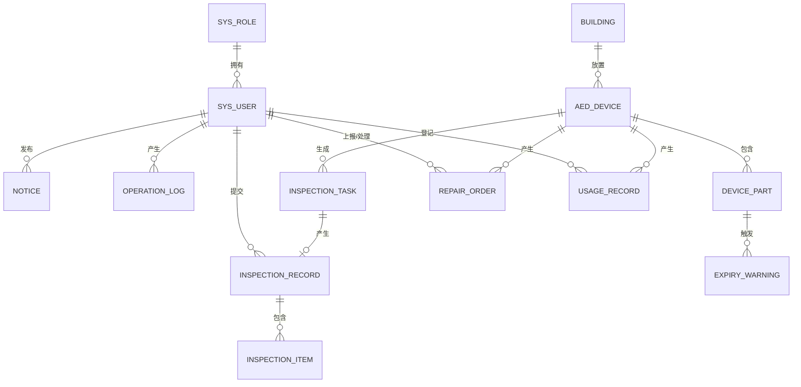

# 高校AED器械管理系统 — 数据库设计

> 本文档为毕业设计论文"数据库设计"章节的素材。

## 1. 设计概述

系统采用 MySQL 关系型数据库，库名 `aed_system`，字符集 utf8mb4。共设计 **13 张数据表**，覆盖用户权限、设备台账、配件管理、巡检、维修、使用记录、预警、公告与日志等全部业务。

设计要点：

- **权限模型**：用户-角色两级模型，3 个角色（系统管理员/设备管理员/巡检人员），简单清晰；
- **逻辑删除**：业务表均含 `deleted` 字段，通过 MyBatis-Plus 逻辑删除机制实现数据可恢复，避免误删；
- **审计字段**：`create_time`/`update_time` 由 MyBatis-Plus 自动填充，`operation_log` 表记录全部写操作；
- **有效期管理**：配件表独立管理电极片/电池的有效期，预警表由定时任务每日扫描生成，实现"到期前提醒、到期后告警"。

## 2. 数据表清单

| 序号 | 表名 | 说明 |
|---|---|---|
| 1 | sys_role | 角色表 |
| 2 | sys_user | 用户表 |
| 3 | building | 楼宇表 |
| 4 | aed_device | AED设备表 |
| 5 | device_part | 设备配件表（电极片/电池） |
| 6 | inspection_task | 巡检任务表 |
| 7 | inspection_record | 巡检记录表 |
| 8 | inspection_item | 巡检明细表 |
| 9 | repair_order | 维修工单表 |
| 10 | usage_record | AED使用记录表 |
| 11 | expiry_warning | 配件到期预警表 |
| 12 | notice | 公告表 |
| 13 | operation_log | 操作日志表 |

## 3. E-R 关系图

## 4. 表结构设计

### 4.1 角色表 sys_role

| 字段名 | 类型 | 允许空 | 说明 |
|---|---|---|---|
| id | BIGINT | 否 | 角色ID，主键自增 |
| role_code | VARCHAR(50) | 否 | 角色编码，唯一 |
| role_name | VARCHAR(50) | 否 | 角色名称 |
| description | VARCHAR(200) | 是 | 角色描述 |
| create_time | DATETIME | 是 | 创建时间 |

### 4.2 用户表 sys_user

| 字段名 | 类型 | 允许空 | 说明 |
|---|---|---|---|
| id | BIGINT | 否 | 用户ID，主键自增 |
| username | VARCHAR(50) | 否 | 登录账号，唯一 |
| password | VARCHAR(100) | 否 | 密码（BCrypt 加密存储） |
| real_name | VARCHAR(50) | 是 | 姓名 |
| phone | VARCHAR(20) | 是 | 联系电话 |
| role_id | BIGINT | 否 | 角色ID，外键关联 sys_role |
| status | TINYINT | 否 | 状态：1-启用 0-禁用 |
| create_time / update_time / deleted | - | - | 审计字段（下同，不再重复列出） |

### 4.3 楼宇表 building

| 字段名 | 类型 | 允许空 | 说明 |
|---|---|---|---|
| id | BIGINT | 否 | 楼宇ID |
| building_name | VARCHAR(100) | 否 | 楼宇名称 |
| campus_area | VARCHAR(100) | 是 | 所属校区 |
| address | VARCHAR(200) | 是 | 位置描述 |
| remark | VARCHAR(500) | 是 | 备注 |

### 4.4 AED设备表 aed_device

| 字段名 | 类型 | 允许空 | 说明 |
|---|---|---|---|
| id | BIGINT | 否 | 设备ID |
| device_code | VARCHAR(50) | 否 | 设备编号（如 AED-001），唯一 |
| device_name | VARCHAR(100) | 否 | 设备型号 |
| brand | VARCHAR(50) | 是 | 品牌 |
| serial_no | VARCHAR(100) | 是 | 序列号 |
| manufacturer | VARCHAR(100) | 是 | 生产厂家 |
| purchase_date | DATE | 是 | 购置日期 |
| service_life | INT | 是 | 设计使用年限（年） |
| building_id | BIGINT | 是 | 所在楼宇ID |
| floor | VARCHAR(20) | 是 | 所在楼层 |
| position_desc | VARCHAR(200) | 是 | 具体位置描述 |
| status | TINYINT | 否 | 状态：0-在用 1-维修中 2-停用 3-已报废 |
| photo | VARCHAR(255) | 是 | 设备照片URL |
| remark | VARCHAR(500) | 是 | 备注 |

### 4.5 设备配件表 device_part

| 字段名 | 类型 | 允许空 | 说明 |
|---|---|---|---|
| id | BIGINT | 否 | 配件ID |
| device_id | BIGINT | 否 | 所属设备ID |
| part_type | TINYINT | 否 | 配件类型：1-电极片 2-电池 |
| batch_no | VARCHAR(50) | 是 | 批次号 |
| install_date | DATE | 是 | 安装日期 |
| expire_date | DATE | 否 | 有效期至 |
| status | TINYINT | 否 | 状态：0-使用中 1-已更换 |
| remark | VARCHAR(200) | 是 | 备注 |

### 4.6 巡检任务表 inspection_task

| 字段名 | 类型 | 允许空 | 说明 |
|---|---|---|---|
| id | BIGINT | 否 | 任务ID |
| device_id | BIGINT | 否 | 设备ID |
| inspector_id | BIGINT | 否 | 巡检人员ID |
| plan_date | DATE | 否 | 计划巡检日期 |
| status | TINYINT | 否 | 状态：0-待巡检 1-已完成 2-已逾期 3-已取消 |
| result | TINYINT | 是 | 巡检结果：1-正常 2-异常 |
| complete_time | DATETIME | 是 | 完成时间 |

### 4.7 巡检记录表 inspection_record

| 字段名 | 类型 | 允许空 | 说明 |
|---|---|---|---|
| id | BIGINT | 否 | 记录ID |
| task_id | BIGINT | 否 | 关联任务ID，唯一 |
| device_id | BIGINT | 否 | 设备ID |
| inspector_id | BIGINT | 否 | 巡检人ID |
| inspect_time | DATETIME | 否 | 巡检时间 |
| result | TINYINT | 否 | 巡检结果：1-正常 2-异常 |
| summary | VARCHAR(500) | 是 | 总体说明 |

### 4.8 巡检明细表 inspection_item

| 字段名 | 类型 | 允许空 | 说明 |
|---|---|---|---|
| id | BIGINT | 否 | 明细ID |
| record_id | BIGINT | 否 | 关联巡检记录ID |
| item_name | VARCHAR(100) | 否 | 检查项名称 |
| item_result | TINYINT | 否 | 检查结果：1-正常 2-异常 |
| remark | VARCHAR(200) | 是 | 异常说明 |

### 4.9 维修工单表 repair_order

| 字段名 | 类型 | 允许空 | 说明 |
|---|---|---|---|
| id | BIGINT | 否 | 工单ID |
| order_no | VARCHAR(50) | 否 | 工单编号（WX+时间戳+随机数），唯一 |
| device_id | BIGINT | 否 | 设备ID |
| report_type | TINYINT | 否 | 报修来源：1-巡检异常 2-手动报修 |
| reporter_id | BIGINT | 否 | 报修人ID |
| fault_desc | VARCHAR(500) | 否 | 故障描述 |
| fault_photo | VARCHAR(255) | 是 | 故障照片URL |
| status | TINYINT | 否 | 状态：0-待处理 1-维修中 2-已完成 3-已驳回 |
| handler_id | BIGINT | 是 | 处理人ID |
| repair_desc | VARCHAR(500) | 是 | 维修说明 |
| repair_cost | DECIMAL(10,2) | 是 | 维修费用（元） |
| repair_time | DATETIME | 是 | 完成维修时间 |
| reject_reason | VARCHAR(200) | 是 | 驳回原因 |

### 4.10 使用记录表 usage_record

| 字段名 | 类型 | 允许空 | 说明 |
|---|---|---|---|
| id | BIGINT | 否 | 记录ID |
| device_id | BIGINT | 否 | 设备ID |
| occur_time | DATETIME | 否 | 使用发生时间 |
| location_desc | VARCHAR(200) | 是 | 事发地点描述 |
| patient_desc | VARCHAR(200) | 是 | 患者情况（匿名描述） |
| result_desc | VARCHAR(500) | 是 | 处置结果 |
| recorder_id | BIGINT | 否 | 登记人ID |
| remark | VARCHAR(500) | 是 | 备注 |

### 4.11 到期预警表 expiry_warning

| 字段名 | 类型 | 允许空 | 说明 |
|---|---|---|---|
| id | BIGINT | 否 | 预警ID |
| part_id | BIGINT | 否 | 配件ID |
| device_id | BIGINT | 否 | 设备ID |
| warning_type | TINYINT | 否 | 预警类型：1-临期（30天内）2-已过期 |
| days_remaining | INT | 否 | 剩余天数（已过期为负数） |
| warning_date | DATE | 否 | 预警生成日期 |
| status | TINYINT | 否 | 状态：0-未处理 1-已处理 |
| handle_desc | VARCHAR(200) | 是 | 处理说明 |
| handle_time | DATETIME | 是 | 处理时间 |

### 4.12 公告表 notice

| 字段名 | 类型 | 允许空 | 说明 |
|---|---|---|---|
| id | BIGINT | 否 | 公告ID |
| title | VARCHAR(200) | 否 | 标题 |
| content | TEXT | 否 | 内容 |
| notice_type | TINYINT | 否 | 类型：1-系统公告 2-急救科普 |
| publisher_id | BIGINT | 否 | 发布人ID |
| status | TINYINT | 否 | 状态：1-已发布 0-草稿 |
| publish_time | DATETIME | 是 | 发布时间 |

### 4.13 操作日志表 operation_log

| 字段名 | 类型 | 允许空 | 说明 |
|---|---|---|---|
| id | BIGINT | 否 | 日志ID |
| user_id | BIGINT | 是 | 操作用户ID |
| username | VARCHAR(50) | 是 | 操作用户名 |
| operation | VARCHAR(100) | 是 | 操作描述（控制器.方法名） |
| method | VARCHAR(200) | 是 | 请求方式与地址 |
| params | VARCHAR(1000) | 是 | 请求参数（JSON，截断至1000字符） |
| ip | VARCHAR(50) | 是 | 请求IP |
| create_time | DATETIME | 是 | 操作时间 |

## 5. 初始数据

- 角色：系统管理员（admin）、设备管理员（device_manager）、巡检人员（inspector）；
- 默认管理员账号 admin/123456，由系统首次启动时通过 BCrypt 加密自动创建（DataInitializer）。
