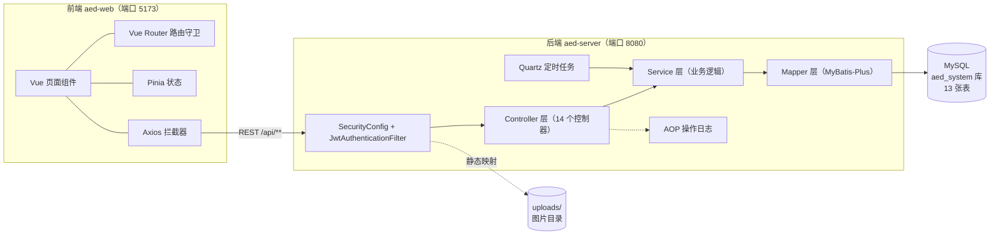
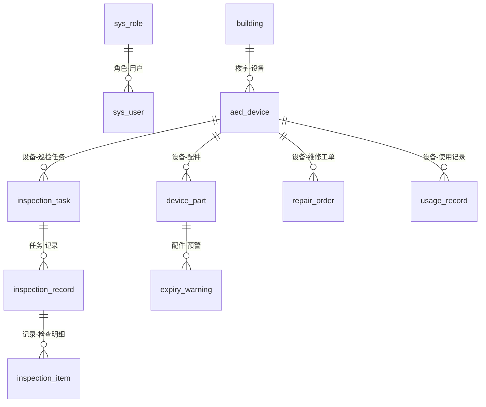
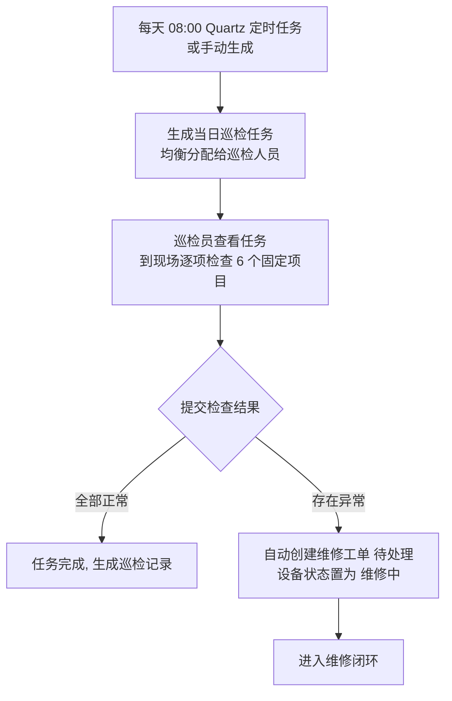
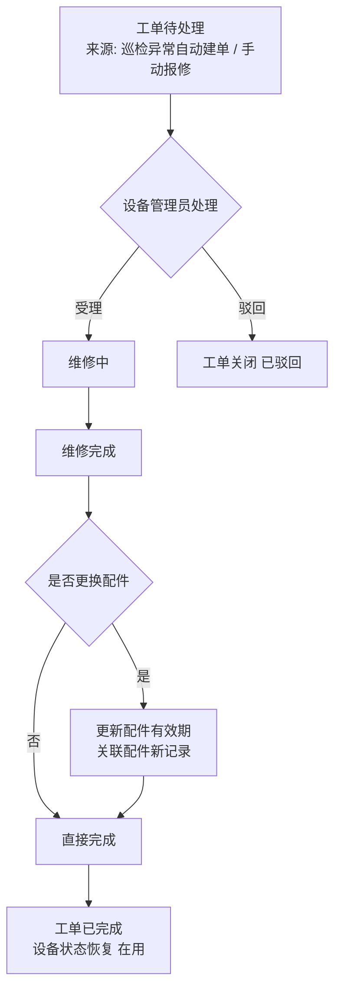
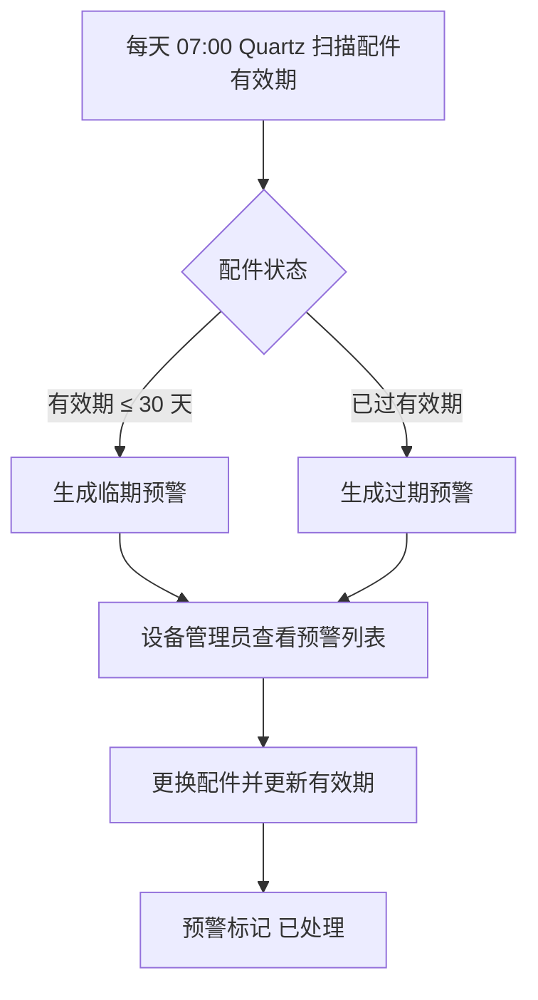
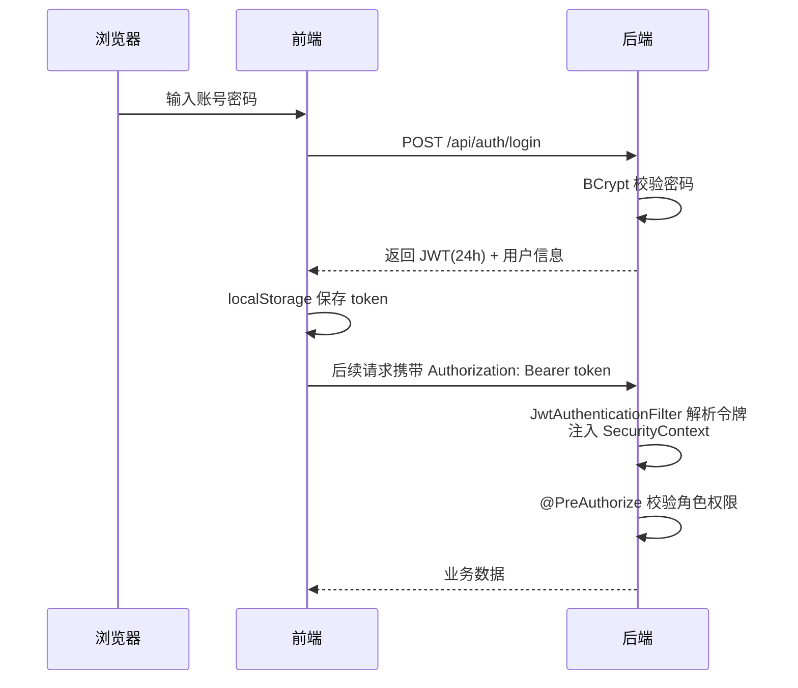

# 高校 AED 器械管理系统 · 项目说明文档

> 毕业设计项目：基于 Spring Boot 的高校 AED 器械管理系统的设计与实现
>
> 文档版本：v1.0（2026-11-08）　·　代码基线：aed-server + aed-web 当前版本

---

## 目录

1. [项目概述](#1-项目概述)
2. [技术选型](#2-技术选型)
3. [系统总体架构](#3-系统总体架构)
4. [角色与权限设计](#4-角色与权限设计)
5. [功能模块说明](#5-功能模块说明)
6. [数据库设计](#6-数据库设计)
7. [API 接口清单](#7-api-接口清单)
8. [核心业务流程](#8-核心业务流程)
9. [定时任务设计](#9-定时任务设计)
10. [关键设计点](#10-关键设计点)
11. [项目目录结构](#11-项目目录结构)
12. [环境要求与启动步骤](#12-环境要求与启动步骤)
13. [演示数据与账号](#13-演示数据与账号)
14. [打包与部署](#14-打包与部署)
15. [常见问题](#15-常见问题)
16. [附录：文档索引](#16-附录文档索引)

---

## 1. 项目概述

### 1.1 项目背景

校园中 AED（自动体外除颤器）是突发心脏骤停急救的关键设备。传统的 AED 管理依赖人工台账和纸质巡检，存在以下问题：

- 设备分布点多面广，状态难以及时掌握；
- 电极片、电池等耗材有有效期，过期失效不易察觉；
- 巡检、维修、预警等环节缺乏流程化、闭环化管理。

### 1.2 系统定位

本项目为**校园 AED 内部运维管理系统**，面向学校后勤/保卫部门，覆盖 AED 设备从**建档 → 巡检 → 维修 → 使用登记 → 到期预警**的全生命周期管理。系统不面向师生开放（无地图分布、无师生角色），定位为内部运营维护工具。

### 1.3 功能范围

| 类别 | 功能 |
|---|---|
| 基础数据 | 设备台账、配件（电极片/电池）管理、楼宇管理、用户管理 |
| 运维流程 | 巡检任务与记录、维修工单流转、使用记录登记 |
| 自动预警 | 配件到期扫描（Quartz 定时任务）→ 生成预警 → 人工处理 |
| 数据展示 | 数据看板（7 个统计维度，ECharts 可视化） |
| 系统管理 | 公告管理、操作日志（AOP 自动记录） |
| 安全认证 | JWT 登录认证、RBAC 角色权限控制 |

---

## 2. 技术选型

### 2.1 前端

| 技术 | 版本 | 用途 |
|---|---|---|
| Vue | 3.5.12 | 渐进式前端框架（组合式 API） |
| Vite | 5.4.9 | 构建工具与开发服务器 |
| Element Plus | 2.8.6 | UI 组件库（表格、表单、弹窗等） |
| ECharts | 5.5.1 | 数据看板可视化图表 |
| Pinia | 2.2.4 | 全局状态管理（用户信息） |
| Vue Router | 4.4.5 | 路由管理 + 登录/角色守卫 |
| Axios | 1.7.7 | HTTP 请求封装（统一拦截器） |

### 2.2 后端

| 技术 | 版本 | 用途 |
|---|---|---|
| Java / JDK | 17 | 开发语言与运行环境 |
| Spring Boot | 3.2.12 | 应用框架 |
| Spring Security | 3.2.x（随 Boot） | 认证授权框架 + JWT 过滤器 |
| MyBatis-Plus | 3.5.7 | ORM（分页、逻辑删除、条件构造器） |
| MySQL Connector/J | 5.1.49 | 数据库驱动（**兼容 MySQL 5.5 服务端**） |
| JJWT | 0.12.6 | JWT 令牌签发与解析 |
| Quartz | 随 Boot | 定时任务调度（巡检生成、预警扫描） |
| Knife4j | 4.5.0 | 在线接口文档（/doc.html） |
| Lombok | 随 Boot | 简化实体类样板代码 |

### 2.3 数据库与环境

| 项目 | 说明 |
|---|---|
| 数据库 | MySQL 5.5+（开发机实际为 5.5.45），库名 `aed_system`，字符集 utf8mb4 |
| 构建工具 | Maven 3.6+（已配置阿里云镜像）、npm（已配置 npmmirror 镜像） |

---

## 3. 系统总体架构

前后端分离架构，前端通过 HTTP REST 接口与后端交互，开发环境由 Vite 代理转发解决跨域。



**分层说明（后端）：**

| 包 | 职责 |
|---|---|
| `controller` | 接收 HTTP 请求，参数校验，调用 Service，返回统一结果 `Result<T>` |
| `service` / `service.impl` | 业务逻辑（含事务、状态流转、联动处理） |
| `mapper` | 数据访问（继承 MyBatis-Plus `BaseMapper`） |
| `entity` / `dto` / `vo` | 数据库实体 / 入参对象 / 出参视图对象 |
| `config` | Spring 配置（安全、MyBatis-Plus、Knife4j、Quartz、数据初始化） |
| `security` | JWT 过滤器、令牌工具、登录用户封装、UserDetailsService |
| `task` | Quartz 定时任务 Job |
| `aspect` | 操作日志切面 |
| `common` / `util` | 统一返回、全局异常、分页封装等公共组件 |

---

## 4. 角色与权限设计

系统采用 **RBAC（基于角色的访问控制）**，共 3 个角色：

| 角色编码 | 角色名称 | 职责与可见菜单 |
|---|---|---|
| `admin` | 系统管理员 | **全部功能**，含用户管理、操作日志、公告管理、楼宇管理 |
| `device_manager` | 设备管理员 | 设备台账、配件管理、楼宇管理、维修工单处理、到期预警处理、数据看板、巡检任务/记录查看、使用记录、公告 |
| `inspector` | 巡检人员 | 巡检任务执行、巡检记录、手动报修、使用记录登记、数据看板、公告 |

**权限控制分两层：**

1. **前端路由/菜单层**：`src/router/index.js` 路由守卫校验 `meta.roles`；`src/config/menu.js` 按角色渲染侧边栏（用户管理、操作日志仅 admin 可见；设备/配件/楼宇仅 admin + device_manager 可见）。
2. **后端接口层**：`SecurityConfig` 中除登录、接口文档、上传文件外全部接口需认证；方法级 `@PreAuthorize` 注解细粒度控制——全后端共 25 处：
   - `hasAnyRole('admin','device_manager')` × 15（设备/配件/楼宇写操作、工单流转、预警处理等）
   - `hasRole('admin')` × 9（用户管理、操作日志等）
   - `hasRole('inspector')` × 1（巡检执行类接口）

---

## 5. 功能模块说明

前端共 13 个页面（1 个登录页 + 12 个业务页面），后端 14 个控制器。

| # | 模块 | 前端页面 | 主要功能 |
|---|---|---|---|
| 1 | 登录 | `Login.vue` | 账号密码登录（BCrypt 校验），签发 JWT（24h 有效），前端存 localStorage |
| 2 | 数据看板 | `Dashboard.vue` | 概览统计卡片 + 设备状态分布、巡检/维修/使用趋势折线、楼宇分布、临期配件列表（ECharts） |
| 3 | 设备台账 | `Device.vue` | 设备多条件分页查询（编号/名称/楼宇/状态）、新增、编辑、状态变更、删除、照片上传、查看配件 |
| 4 | 配件管理 | `Part.vue` | 电极片/电池配件的增删改查、有效期管理、关联设备、到期状态标识 |
| 5 | 巡检任务 | `InspectionTask.vue` | 任务分页查看、手动生成任务、任务详情（含 6 个固定检查项） |
| 6 | 巡检记录 | `InspectionRecord.vue` | 执行巡检、逐项打勾提交结果、记录详情（含检查明细）、异常自动建单 |
| 7 | 维修工单 | `Repair.vue` | 手动报修、工单分页（按状态筛选）、受理 → 维修中 → 完成（配件联动）/ 驳回 |
| 8 | 使用记录 | `Usage.vue` | 登记 AED 使用情况（时间/地点/结果）、分页查看、详情 |
| 9 | 到期预警 | `Warning.vue` | 预警分页（临期/过期）、处理预警（更换配件后更新有效期） |
| 10 | 公告管理 | `Notice.vue` | 公告发布、编辑、删除、详情 |
| 11 | 楼宇管理 | `Building.vue` | 楼宇增删改查（名称/校区/位置描述） |
| 12 | 用户管理 | `User.vue` | 用户增删改查、启用/禁用、角色分配、重置密码 |
| 13 | 操作日志 | `Log.vue` | 操作日志分页查看（AOP 自动记录：操作人/操作内容/IP/时间） |

**巡检固定检查项（6 项，系统内置）：**

1. 主机外观完好无破损
2. 电源指示灯显示正常
3. 电极片在有效期内
4. 电池电量充足
5. 机柜箱体完好
6. 设备周边无障碍物

---

## 6. 数据库设计

数据库 `aed_system`（utf8mb4），共 **13 张表**，统一使用 `BIGINT` 自增主键、`create_time/update_time` 审计字段、`deleted` 逻辑删除标记（0 未删除 / 1 已删除，由 MyBatis-Plus 自动过滤）。

| # | 表名 | 说明 | 关键字段 |
|---|---|---|---|
| 1 | `sys_role` | 角色表 | role_code, role_name, description |
| 2 | `sys_user` | 用户表 | username(唯一), password(BCrypt), real_name, phone, role_id, status(1启用/0禁用) |
| 3 | `building` | 楼宇表 | building_name, campus_area, address, remark |
| 4 | `aed_device` | AED 设备表 | device_code, device_name, brand, serial_no, manufacturer, purchase_date, service_life, building_id, floor, position_desc, **status(0在用/1维修中/2停用/3已报废)**, photo |
| 5 | `device_part` | 配件表 | 关联 device_id, part_type(电极片/电池), **expiry_date 有效期** |
| 6 | `inspection_task` | 巡检任务表 | 关联 device_id, inspector_id, task_date, **status(待执行/已完成等)**, 生成来源(定时/手动) |
| 7 | `inspection_record` | 巡检记录表 | 关联 task_id, 结论(正常/异常), 异常描述 |
| 8 | `inspection_item` | 巡检明细表 | 关联 record_id, 6 个固定检查项的名称与检查结果 |
| 9 | `repair_order` | 维修工单表 | 关联 device_id, 报修人/受理人, **status(待处理/维修中/已完成/已驳回)**, 来源(巡检异常自动建单/手动报修) |
| 10 | `usage_record` | 使用记录表 | 关联 device_id, 使用时间/地点/结果 |
| 11 | `expiry_warning` | 到期预警表 | 关联 part_id, 预警类型(临期/过期), **status(未处理/已处理)** |
| 12 | `notice` | 公告表 | title, content, 发布人 |
| 13 | `operation_log` | 操作日志表 | 操作人, 操作内容, IP, 操作时间 |

**核心表关系：**



---

## 7. API 接口清单

后端共 **55 个接口**，统一前缀 `/api`，统一返回结构 `Result<T>`（`code` / `message` / `data`）。完整参数与响应结构见 Knife4j 在线文档（`http://localhost:8080/doc.html`）及 `docs/API接口设计.md`。

### 7.1 认证（/api/auth，3 个）

| 方法 | 路径 | 说明 | 权限 |
|---|---|---|---|
| POST | /api/auth/login | 登录，返回 JWT + 用户信息 | 匿名 |
| GET | /api/auth/info | 获取当前登录用户信息 | 登录 |
| PUT | /api/auth/password | 修改本人密码 | 登录 |

### 7.2 用户管理（/api，5 个）

| 方法 | 路径 | 说明 | 权限 |
|---|---|---|---|
| GET | /api/user/page | 用户分页查询 | admin |
| POST | /api/user | 新增用户 | admin |
| PUT | /api/user | 修改用户（含启用/禁用、角色调整） | admin |
| DELETE | /api/user/{id} | 删除用户（逻辑删除） | admin |
| GET | /api/role/list | 角色下拉列表 | 登录 |

### 7.3 设备台账（/api/device，7 个）

| 方法 | 路径 | 说明 | 权限 |
|---|---|---|---|
| GET | /api/device/page | 设备分页（编号/名称/楼宇/状态多条件） | 登录 |
| GET | /api/device/list | 设备下拉列表 | 登录 |
| GET | /api/device/{id} | 设备详情（含配件） | 登录 |
| POST | /api/device | 新增设备 | admin / device_manager |
| PUT | /api/device | 修改设备 | admin / device_manager |
| PUT | /api/device/status | 变更设备状态 | admin / device_manager |
| DELETE | /api/device/{id} | 删除设备（逻辑删除） | admin / device_manager |

### 7.4 配件管理（/api/part，5 个）

| 方法 | 路径 | 说明 | 权限 |
|---|---|---|---|
| GET | /api/part/page | 配件分页查询 | 登录 |
| GET | /api/part/list | 配件列表（按设备过滤） | 登录 |
| POST | /api/part | 新增配件 | admin / device_manager |
| PUT | /api/part | 修改配件（含更换后更新有效期） | admin / device_manager |
| DELETE | /api/part/{id} | 删除配件 | admin / device_manager |

### 7.5 楼宇管理（/api/building，4 个）

| 方法 | 路径 | 说明 | 权限 |
|---|---|---|---|
| GET | /api/building/list | 楼宇列表 | 登录 |
| POST | /api/building | 新增楼宇 | admin / device_manager |
| PUT | /api/building | 修改楼宇 | admin / device_manager |
| DELETE | /api/building/{id} | 删除楼宇 | admin / device_manager |

### 7.6 巡检任务（/api/inspection/task，3 个）

| 方法 | 路径 | 说明 | 权限 |
|---|---|---|---|
| GET | /api/inspection/task/page | 任务分页（按日期/状态/巡检人筛选） | 登录 |
| POST | /api/inspection/task/generate | 手动生成当日巡检任务（均衡分配） | admin / device_manager |
| GET | /api/inspection/task/{id} | 任务详情（含 6 个检查项） | 登录 |

### 7.7 巡检记录（/api/inspection/record，3 个）

| 方法 | 路径 | 说明 | 权限 |
|---|---|---|---|
| POST | /api/inspection/record/submit | 提交巡检结果（逐项勾选） | inspector |
| GET | /api/inspection/record/page | 巡检记录分页 | 登录 |
| GET | /api/inspection/record/{id} | 记录详情（含检查明细） | 登录 |

### 7.8 维修工单（/api/repair，6 个）

| 方法 | 路径 | 说明 | 权限 |
|---|---|---|---|
| GET | /api/repair/page | 工单分页（按状态筛选） | 登录 |
| POST | /api/repair | 手动报修 | 登录 |
| POST | /api/repair/{id}/accept | 受理工单（待处理 → 维修中） | admin / device_manager |
| POST | /api/repair/{id}/complete | 完成工单（可联动更新配件、恢复设备状态） | admin / device_manager |
| POST | /api/repair/{id}/reject | 驳回工单 | admin / device_manager |
| GET | /api/repair/{id} | 工单详情 | 登录 |

### 7.9 使用记录（/api/usage，3 个）

| 方法 | 路径 | 说明 | 权限 |
|---|---|---|---|
| POST | /api/usage | 登记使用记录（登记人取当前用户） | 登录 |
| GET | /api/usage/page | 使用记录分页 | 登录 |
| GET | /api/usage/{id} | 使用记录详情 | 登录 |

### 7.10 到期预警（/api/warning，2 个）

| 方法 | 路径 | 说明 | 权限 |
|---|---|---|---|
| GET | /api/warning/page | 预警分页（未处理/已处理筛选） | 登录 |
| POST | /api/warning/{id}/handle | 处理预警 | admin / device_manager |

### 7.11 公告管理（/api/notice，5 个）

| 方法 | 路径 | 说明 | 权限 |
|---|---|---|---|
| GET | /api/notice/page | 公告分页 | 登录 |
| GET | /api/notice/{id} | 公告详情 | 登录 |
| POST | /api/notice | 发布公告 | admin / device_manager |
| PUT | /api/notice | 修改公告 | admin / device_manager |
| DELETE | /api/notice/{id} | 删除公告 | admin / device_manager |

### 7.12 操作日志（/api/log，1 个）

| 方法 | 路径 | 说明 | 权限 |
|---|---|---|---|
| GET | /api/log/page | 操作日志分页 | admin |

### 7.13 文件上传（/api/file，1 个）

| 方法 | 路径 | 说明 | 权限 |
|---|---|---|---|
| POST | /api/file/upload | 图片上传（设备照片，≤10MB），返回可访问 URL | 登录 |

### 7.14 数据看板（/api/dashboard，7 个）

| 方法 | 路径 | 说明 | 权限 |
|---|---|---|---|
| GET | /api/dashboard/overview | 概览统计卡片（设备总数/在用/巡检任务/待处理工单等） | 登录 |
| GET | /api/dashboard/deviceStatus | 设备状态分布（饼图） | 登录 |
| GET | /api/dashboard/inspectionTrend | 巡检完成趋势（近 7 天） | 登录 |
| GET | /api/dashboard/repairTrend | 维修工单趋势（近 7 天） | 登录 |
| GET | /api/dashboard/usageTrend | 使用记录趋势（近 7 天） | 登录 |
| GET | /api/dashboard/buildingDist | 楼宇设备分布（柱状图） | 登录 |
| GET | /api/dashboard/expiringList | 临期/过期配件列表 | 登录 |

---

## 8. 核心业务流程

### 8.1 巡检闭环



### 8.2 维修闭环



### 8.3 到期预警闭环



### 8.4 登录认证流程



---

## 9. 定时任务设计

基于 **Quartz**（内存存储模式 `job-store-type: memory`），共 2 个 Job：

| Job 类 | Cron 表达式 | 执行时间 | 业务逻辑 |
|---|---|---|---|
| `InspectionTaskGenerateJob` | `0 0 8 * * ?` | 每天 08:00 | 为所有「在用」设备生成当日巡检任务，并均衡分配给启用状态的巡检人员 |
| `ExpiryWarningJob` | `0 0 7 * * ?` | 每天 07:00 | 扫描全部配件：有效期 ≤ 30 天生成「临期」预警；已过有效期生成「过期」预警（幂等处理，不重复生成） |

> 任务定义见 `config/QuartzConfig.java`。两个任务均提供前端手动触发入口（生成任务、处理预警），保证演示和答辩时不受时间限制。

---

## 10. 关键设计点

### 10.1 JWT 认证
- 登录成功后签发 HS256 签名 JWT，有效期 24 小时（`jwt.expire-hours` 可配）；
- 请求头 `Authorization: Bearer <token>`，由 `JwtAuthenticationFilter` 解析并构建 `SecurityContext`；
- 角色编码转为 `ROLE_` 前缀权限标识，供 `@PreAuthorize("hasRole('admin')")` 使用；
- 签名密钥在 `application.yml` 中配置，正式部署前应更换。

### 10.2 密码安全
- 所有用户密码以 **BCrypt** 密文存储（`sys_user.password`）；
- 首次启动由 `DataInitializer`（CommandLineRunner）自动创建默认管理员 `admin/123456`（依赖 `sql/init.sql` 已插入 3 个角色）。

### 10.3 统一响应与异常处理
- 所有接口返回统一结构 `Result<T>`：`code`（0 成功 / 非 0 失败）、`message`、`data`；
- 全局异常处理器统一捕获业务异常、参数校验异常，返回友好提示；前端 Axios 响应拦截器统一弹错、401 自动跳转登录。

### 10.4 逻辑删除
- 13 张表统一 `deleted` 字段，MyBatis-Plus 全局配置逻辑删除（删除改为 `deleted=1`），查询自动过滤，数据可追溯。

### 10.5 操作日志（AOP）
- 自定义注解 + `@Aspect` 切面，环绕 Controller 写操作自动记录：操作人、操作内容、请求参数、IP、时间，写入 `operation_log` 表。

### 10.6 文件上传
- 图片保存至后端运行目录 `uploads/`（`upload.path` 可配），单文件 ≤10MB；
- 通过 `/upload/**` 静态映射访问（免认证）；前端 Vite 代理 `/upload` 转发至后端。

### 10.7 前后端联调
- 开发环境 Vite 代理：`/api`、`/upload` → `http://localhost:8080`，无跨域问题；
- Jackson 统一日期格式、MyBatis-Plus 驼峰映射开箱即用。

---

## 11. 项目目录结构

```
毕业设计代码/
├── README.md                    # 快速上手说明
├── aed-server/                  # 后端 Spring Boot（端口 8080）
│   ├── pom.xml                  # Maven 依赖（Spring Boot 3.2.12 / JDK 17）
│   ├── uploads/                 # 上传的图片（运行时生成）
│   └── src/main/
│       ├── java/com/campus/aed/
│       │   ├── aspect/          # 操作日志切面
│       │   ├── common/          # 统一返回、全局异常、分页封装
│       │   ├── config/          # Security/MyBatis-Plus/Knife4j/Quartz/数据初始化
│       │   ├── controller/      # 14 个 REST 控制器
│       │   ├── dto/             # 入参对象（含查询、校验注解）
│       │   ├── entity/          # 13 个数据库实体
│       │   ├── mapper/          # MyBatis-Plus Mapper
│       │   ├── security/        # JWT 过滤器/工具/登录用户
│       │   ├── service/ + impl/ # 业务逻辑
│       │   ├── task/            # 2 个 Quartz Job
│       │   ├── util/            # 工具类
│       │   └── vo/              # 视图对象
│       └── resources/application.yml
├── aed-web/                     # 前端 Vue3 + Vite（端口 5173）
│   ├── vite.config.js           # 端口/别名/代理配置
│   └── src/
│       ├── api/                 # 13 个接口模块封装（auth/device/part/...）
│       ├── config/menu.js       # 侧边栏菜单（按角色过滤）
│       ├── layout/Layout.vue    # 整体布局（侧边栏+顶栏+内容区）
│       ├── router/index.js      # 路由 + 登录/角色守卫
│       ├── stores/user.js       # Pinia 用户状态
│       ├── utils/request.js     # Axios 封装（token/401/错误弹窗）
│       └── views/               # 13 个页面组件
├── sql/
│   ├── init.sql                 # 建库建表（13 张表 + 3 个角色）
│   └── demo_data.sql            # 演示数据（可选）
├── docs/                        # 设计与论文素材
│   ├── 数据库设计.md
│   ├── API接口设计.md
│   ├── 前端设计.md
│   └── 项目说明文档.md          # 本文档
└── tests/
    └── api-smoke.sh             # 接口冒烟测试脚本
```

---

## 12. 环境要求与启动步骤

### 12.1 环境要求

| 软件 | 版本要求 |
|---|---|
| JDK | 17（开发机 17.0.12） |
| Maven | 3.6+（已配置阿里云镜像） |
| Node.js | 18+（开发机 22.14，npm 已配置 npmmirror） |
| MySQL | 5.5 及以上（原开发环境为 5.5.45） |

### 12.2 启动步骤

**第一步：初始化数据库**

```bash
mysql -uroot -p --default-character-set=utf8mb4 < sql/init.sql
```

> 建库 `aed_system` + 13 张表 + 3 个角色。**默认管理员 admin/123456 由后端首次启动时自动创建**（BCrypt 加密）。

**第二步：启动后端（终端 1）**

```bash
cd aed-server
mvn spring-boot:run
```

- 首次启动自动创建 admin 账号，日志输出「已创建默认管理员账号: admin / 123456」；
- 接口文档：<http://localhost:8080/doc.html>（Knife4j）。

**第三步：启动前端（终端 2）**

```bash
cd aed-web
npm install     # 首次运行需要
npm run dev
```

- 浏览器访问：<http://localhost:5173>。

**第四步（可选）：导入演示数据**（含 12 台设备、巡检任务、维修工单、预警等完整业务场景，答辩演示推荐导入）

```bash
mysql -uroot -p --default-character-set=utf8mb4 aed_system < sql/demo_data.sql
```

---

## 13. 演示数据与账号

### 13.1 演示账号（密码均为 `123456`）

| 账号 | 姓名 | 角色 | 演示场景 |
|---|---|---|---|
| admin | 系统管理员 | admin | 用户管理、操作日志、公告发布 |
| zhangwei | 张伟 | device_manager | 设备台账、配件、工单处理、预警处理 |
| liming | 李明 | device_manager | 同上 |
| wangfang | 王芳 | inspector | 巡检任务执行、异常上报 |
| liuyang | 刘洋 | inspector | 同上 |
| chenjing | 陈静 | inspector | 同上 |

### 13.2 演示数据规模（时间线围绕 2026-10-28）

| 数据 | 数量 | 数据 | 数量 |
|---|---|---|---|
| 用户 | 6 | 维修工单 | 4 |
| 楼宇 | 5 | 使用记录 | 4 |
| AED 设备 | 12 | 到期预警 | 8 |
| 配件 | 26 | 公告 | 3 |
| 巡检任务 | 19 | 巡检记录/明细 | 12 条 / 72 项 |

演示数据刻意覆盖了答辩需要的典型场景：配件临期与过期、待执行/已完成巡检任务、不同状态的维修工单等，数据看板各统计数字与演示数据精确对应。

---

## 14. 打包与部署

### 14.1 后端打包

```bash
cd aed-server
mvn clean package -DskipTests
# 产物: target/aed-server-1.0.0.jar
java -jar target/aed-server-1.0.0.jar
```

### 14.2 前端打包

```bash
cd aed-web
npm run build
# 产物: dist/，可部署到 Nginx
```

**生产部署建议：**
- 前端 `dist/` 部署到 Nginx，并将 `/api`、`/upload` 反向代理到后端 8080 端口；
- 从 `aed-server/application-local.example.yml` 复制生成 `application-local.yml`，设置数据库密码和 JWT 密钥（至少 32 字节）；本地配置不提交 Git。上传目录见 `application.yml`。
- 后端以 `nohup java -jar ... > aed.log 2>&1 &` 方式后台运行。

---

## 15. 常见问题

| 问题 | 原因与解决 |
|---|---|
| MySQL 连接报错 | 本项目兼容 MySQL 5.5，后端固定使用 `mysql-connector-java 5.1.49` 驱动与 `com.mysql.jdbc.Driver`，**请勿升级为 8.x 驱动** |
| 端口占用 | 后端 8080、前端 5173；修改 [application.yml](aed-server/src/main/resources/application.yml) 或 [vite.config.js](aed-web/vite.config.js)，注意代理 target 同步修改 |
| 图片不显示 | 图片保存在后端 `aed-server/uploads/` 目录，经 `/upload/**` 静态映射访问；确认后端运行目录下有该文件夹 |
| 登录后 401 | token 过期（24h）或未携带 `Authorization` 头；前端会自动跳转登录页 |
| 忘记改数据库密码 | 检查本地 `application-local.yml` 中的数据库密码或 `DB_PASSWORD` 环境变量；导入时使用 `-p` 交互输入密码 |
| 首次启动报缺表/缺列 | 确认已执行最新版 `sql/init.sql`（历史上曾修复 6 张表缺 `update_time` 列的问题，脚本已同步） |
| 演示数据重复导入 | `demo_data.sql` 使用固定主键 INSERT，重复执行会报主键冲突；如需重导，先重新执行 `init.sql` 清库 |

---

## 16. 附录：文档索引

| 文档 | 说明 |
|---|---|
| [README.md](../README.md) | 快速上手（精简版运行说明） |
| [数据库设计.md](数据库设计.md) | 13 张表完整字段定义、索引、设计说明 |
| [API接口设计.md](API接口设计.md) | 接口详细设计（请求/响应示例） |
| [前端设计.md](前端设计.md) | 前端页面设计、组件结构、交互说明 |
| `tests/api-smoke.sh` | 后端接口冒烟测试脚本（登录 + 核心读接口） |
| Knife4j 在线文档 | 启动后端后访问 <http://localhost:8080/doc.html> |
